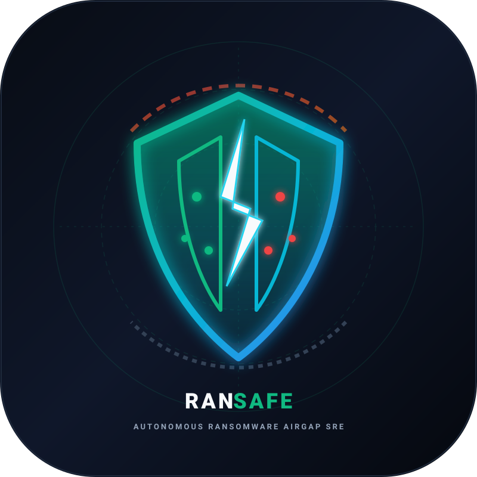

  

<h1 align="center">RanSafe</h1>

  <strong>Autonomous "Ransomware Airgap" SRE Orchestrator</strong> 
  <em>Built for the Google Cloud Rapid Agent Hackathon (Dynatrace Track)</em>

  
  
  
  
  

---

## 📋 Overview

**RanSafe** is an automated, real-time, state-mutating Site Reliability Engineering (SRE) and cybersecurity agent. It is designed specifically to act as an immediate, autonomous circuit breaker for cloud infrastructure when a devastating cyberattack occurs. Leveraging **Google Cloud Agent Builder** and **Gemini 3** for reasoning, RanSafe hooks directly into full-stack application performance metrics via a **Dynatrace Model Context Protocol (MCP) Server**.

---

## 📖 Submission Walkthrough & Demo Guide

To demonstrate or test the RanSafe orchestrator locally and in Google Cloud, please follow the step-by-step setup and live demo guide in **[SUBMISSION_WALKTHROUGH.md](SUBMISSION_WALKTHROUGH.md)**.

---

## 🚨 The Problem & The Solution

* **The Problem:** When ransomware breaches an enterprise cloud cluster, it spreads laterally across microservices in a matter of seconds. Human IT teams and traditional monitoring systems are fundamentally too slow to isolate the infected nodes before data is permanently encrypted.
* **The Solution:** An active, autonomous cybersecurity orchestrator. RanSafe continuously monitors high-frequency telemetry, looking for massive CPU spikes paired with irregular file-write operations. When detected, it autonomously executes firewall rules to instantly "airgap" (sever network access to) the compromised compute node, spins up an uninfected replica cluster, and dynamically updates proxy routing configs to shift user traffic to safety.

---

## 🛠️ Technology Stack

* **Reasoning Core:** Gemini 3
* **Orchestration & Grounding:** Google Cloud Agent Builder
* **System Observability:** Dynatrace Model Context Protocol (MCP) Server
* **Development Environment:** Antigravity IDE

---

## 🗺️ 4-Member Async Execution Roadmap & Lane Assignments

To ensure high-velocity, concurrent development without anyone getting blocked, the repository responsibilities are divided into four highly specialized operational lanes:

* **Lane 1: Backend & Threat Simulation (`/sandbox`)**
  * **Core Focus:** Building the victim microservice environment and writing the localized, safe file-encryption attack script (`sandbox/malware_sim.sh`).
* **Lane 2: Cloud Ops & System Management (`/observability`)**
  * **Core Focus:** Deploying the local cluster configuration, linking it to the Dynatrace environment, and standing up the Model Context Protocol (MCP) telemetry server.
* **Lane 3: AI Core & Orchestration (`/agent`)**
  * **Core Focus:** Wiring up Google Cloud Agent Builder, initializing Gemini 3, and authoring the precision threshold evaluation system prompts.
* **Lane 4: Infrastructure Execution & UX (`/execution`)**
  * **Core Focus:** Coding the state-mutating shell/Kubernetes handlers that execute the `AIRGAP_NODE` command, and designing the sleek terminal interface for the 3-minute demo video.

---

## 🤝 Architectural Handshakes (API Specifications)

True asynchronous cross-lane engineering is governed by two immutable schemas located inside the `/docs` folder, ensuring teams can write software in parallel without overwriting each other's work:

### 1. Telemetry Schema (`/docs/telemetry_schema.json`)
Establishes the exact JSON data contract that dictates what JSON data Dynatrace will pull and pass to Gemini 3 via the MCP. 

### 2. Execution Interface (`/docs/execution_interface.json`)
Defines how the Google Cloud Agent Builder runtime payload translates an optimization or mitigation decision into a structured command payload that can fire off state-mutating network shell commands.

---

## 🔮 Engineering Roadmap

For details on sub-second eBPF entropy detection, Kubernetes NetworkPolicy microsegmentation, and zero-downtime proxy traffic rerouting, check out the comprehensive [future.md](future.md).

---

## ⚖️ License

Distributed under the Apache License 2.0. See the `LICENSE` file at the top level of this repository for exact licensing terms.
